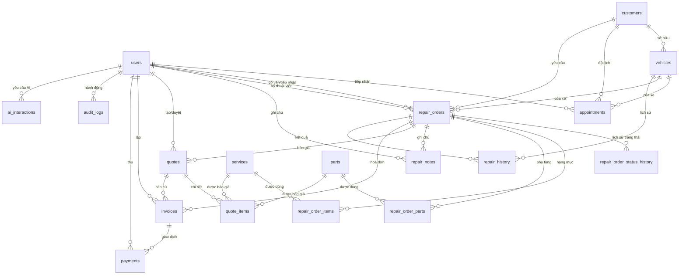

# Thiết kế cơ sở dữ liệu — Hệ thống quản lý garage ô tô (GarageAI)

Tài liệu mô tả thiết kế cơ sở dữ liệu quan hệ cho hệ thống quản lý garage sửa chữa ô tô
có tích hợp AI. Thiết kế đã được hiện thực hoá trong dự án:

| Thành phần | Tệp |
| --- | --- |
| DDL cấu trúc đích (nguồn duy nhất cho bảng) | `backend/schema.sql` |
| Migration (tạo mới & nâng cấp cấu trúc) | `backend/migrations.py` |
| Tiện ích tiền tệ (`Decimal`, đơn vị đồng) | `backend/money.py` |
| Tiện ích thời gian (UTC lưu trữ, VN hiển thị) | `backend/timeutil.py` |
| Kết nối, transaction, dữ liệu mẫu | `backend/database.py` |

---

## 1. Quy ước chung

| Chủ đề | Quy ước |
| --- | --- |
| Khóa chính | `id INTEGER PRIMARY KEY AUTOINCREMENT` |
| Khóa ngoại | Khai báo `REFERENCES ... ON UPDATE CASCADE ON DELETE ...`, luôn bật `PRAGMA foreign_keys = ON` |
| Tiền tệ | `INTEGER` **đồng** (VND không có phần lẻ thập phân), có `CHECK (cột >= 0)`. Mọi phép tính dùng `decimal.Decimal` rồi làm tròn về đồng — **không dùng floating-point** |
| Thời điểm (instant) | `TEXT` ISO‑8601 UTC `YYYY-MM-DDTHH:MM:SSZ`; API trả về theo giờ Việt Nam (UTC+7) |
| Ngày nghiệp vụ (date‑only) | `TEXT` `YYYY-MM-DD` (ví dụ `repair_history.repaired_at`, `invoices.due_at`) |
| Xóa mềm | Cột `status` (`active/archived`, `Chưa thanh toán/Đã hủy`…) thay cho xóa cứng. Trigger chặn `DELETE` trên dữ liệu tài chính/lịch sử |
| Biển số | Lưu bản hiển thị `plate` + bản chuẩn hóa `plate_normalized` (bỏ `-`, `.`, khoảng trắng, viết hoa). **Không đặt UNIQUE trên biển số** — biển số có thể đổi khi sang tên/đổi biển, không phải định danh vĩnh viễn. Tra cứu dùng `plate_normalized` có chỉ mục |
| Số VIN | `vin` duy nhất **một phần** (`WHERE vin IS NOT NULL AND vin <> ''`) — định danh kỹ thuật của xe khi có |
| Giá tại thời điểm | `repair_order_items`, `repair_order_parts`, `quote_items`, `invoices` lưu **snapshot** tên + đơn giá + thành tiền, không tham chiếu giá hiện hành |
| `updated_at` | Tự động cập nhật bằng trigger `AFTER UPDATE` |

---

## 2. Sơ đồ quan hệ (ERD)



---

## 3. Chi tiết bảng

### 3.1 `users` — tài khoản
| Cột | Kiểu | Ràng buộc |
| --- | --- | --- |
| `id` | INTEGER | PK |
| `full_name` | TEXT | NOT NULL |
| `email` | TEXT | NOT NULL, **UNIQUE** |
| `phone` | TEXT | |
| `password_hash` | TEXT | NOT NULL — **mật khẩu băm PBKDF2‑SHA256**, không lưu văn bản thuần |
| `password_algo` | TEXT | NOT NULL, mặc định `pbkdf2_sha256` |
| `role` | TEXT | CHECK ∈ {Admin, Quản lý, Lễ tân, Kỹ thuật viên, Thu ngân, Khách hàng} |
| `status` | TEXT | CHECK ∈ {`active`, `locked`, `disabled`} — trạng thái tài khoản |
| `created_at`, `updated_at` | TEXT | UTC |

Chỉ mục: `ix_users_role`, `ix_users_status`.

### 3.2 `customers` — khách hàng (tách khỏi xe)
`id` (PK), `name` (NOT NULL, chỉ mục), `phone` (NOT NULL), `email`, `address`, `note`,
`status` (`active`/`archived`), `created_at`, `updated_at`.
Chỉ mục: `ix_customers_name`, `ix_customers_phone`, `ix_customers_email`.
Quan hệ **1‑n**: một khách hàng — nhiều `vehicles`, nhiều `appointments`, nhiều `repair_orders`.

### 3.3 `vehicles` — xe
`id` (PK), `customer_id` (FK → `customers`, NOT NULL, `ON DELETE RESTRICT`),
`plate` (NOT NULL), `plate_normalized` (NOT NULL, chỉ mục — **không UNIQUE**),
`vin` (UNIQUE một phần khi khác rỗng), `make`, `model`, `year` (CHECK 1900–2100),
`color`, `mileage` (CHECK ≥ 0), `status`, `created_at`, `updated_at`.
Chỉ mục: `ix_vehicles_plate_norm`, `ix_vehicles_customer`, `ux_vehicles_vin` (partial unique).

> Vì sao không UNIQUE biển số: biển số là thuộc tính tra cứu, có thể trùng/đổi khi
> sang tên đổi chủ hoặc đổi biển; định danh thật của xe là `id` (và `vin` khi có).
> Tầng ứng dụng vẫn cảnh báo trùng biển số (HTTP 409) để tránh nhập nhầm.

### 3.4 `services` — danh mục dịch vụ
`id` (PK), `code` (UNIQUE), `name` (NOT NULL, UNIQUE), `category`, `description`,
`price` (INTEGER đồng — **giá công tham khảo**, CHECK ≥ 0),
`duration_min` (INTEGER, CHECK > 0 — **thời lượng dự kiến**), `active`, `created_at`, `updated_at`.
Chỉ mục: `ix_services_category`, `ix_services_active`.

### 3.5 `parts` — phụ tùng
`id` (PK), `code` (NOT NULL, UNIQUE), `name` (NOT NULL), `category`, `compatible`, `unit`,
`cost_price` (giá nhập), `sell_price` (**giá bán**, INTEGER, CHECK ≥ 0),
`stock` (CHECK ≥ 0), `min_stock` (**mức tồn tối thiểu**, CHECK ≥ 0), `supplier`, `active`, thời gian.
Chỉ mục: `ix_parts_category`, `ix_parts_name`, `ix_parts_stock`.

### 3.6 `appointments` — lịch hẹn
`id` (PK), `customer_id` (FK), `vehicle_id` (FK), `customer_name` + `plate` (snapshot hiển thị),
`service`, `reason`, `note`, `appointment_at` (UTC, chỉ mục), `duration_min`, `status`
(CHECK ∈ {Đang chờ, Đã xác nhận, Đã tiếp nhận, Đã hủy}), `created_by` (FK users), thời gian.
Chỉ mục: `ix_appointments_at`, `ix_appointments_status`, `ix_appointments_vehicle`, `ix_appointments_customer`.

### 3.7 `repair_orders` — phiếu sửa chữa
`id` (PK), `code` (NOT NULL, UNIQUE), `customer_id` (FK — khách hàng),
`vehicle_id` (FK — xe), `plate` + `customer_name` (snapshot),
`advisor_id` (FK users — **người tiếp nhận**), `technician_id` (FK users — **kỹ thuật viên phụ trách**),
`technician` (snapshot tên), `status` (nhãn tiếng Việt), `status_code` (mã chuẩn, CHECK ∈ 10 trạng thái),
`priority` (CHECK ∈ {Thấp, Bình thường, Cao, Gấp}), `km_in`, `initial_condition`, `customer_request`,
`inspection_notes`, `note`, `cancel_reason`, `total` (INTEGER), `received_at`, `completed_at`,
`delivered_at`, `opened_at`, `closed_at`, `created_at`, `updated_at`.
Chỉ mục: `ix_repair_orders_status/status_code/vehicle/customer/technician/plate`, `ix_repair_orders_received`.

### 3.7.1 `repair_order_status_history` — lịch sử trạng thái bất biến
`id` (PK), `repair_order_id` (FK → `repair_orders`, CASCADE), `from_status`, `to_status`
(mã chuẩn), `note` (lý do, bắt buộc với hủy/tạm dừng/chờ phụ tùng), `changed_by` (FK users),
`changed_by_name` (snapshot), `created_at` (UTC). Chỉ mục: `ix_repair_order_history_order`.
Trigger `trg_repair_order_history_no_update/no_delete` chặn sửa/xóa; mỗi lần chuyển trạng thái
ghi đúng một dòng trong cùng transaction với cập nhật phiếu.

### 3.7.2 `inventory_transactions` — sổ giao dịch kho
Ghi các thao tác `STOCK_IN`, `CONSUME`, `REVERSE` với `part_id`, số lượng, tồn sau giao dịch,
phiếu sửa chữa/dòng phụ tùng liên quan, người thực hiện và thời gian. `idempotency_key` có
unique index để request gửi lại không tạo giao dịch thứ hai. Xuất kho cập nhật bằng điều kiện
`stock >= quantity` trong transaction; hoàn kho tạo giao dịch đảo chiều trước khi xóa dòng sử dụng.

### 3.7.3 Báo giá và hóa đơn
`quotes` có `tax_rate`, `valid_until`; `invoice_items` lưu snapshot dòng hạng mục từ báo giá được
duyệt để hóa đơn không thay đổi khi danh mục gốc thay đổi. `payments.idempotency_key` có unique
index; `reference_code` được unique theo hóa đơn khi không rỗng. Migration `009` bổ sung các trường,
chỉ mục và bảng snapshot này.

### 3.8 `repair_order_items` — hạng mục sửa chữa (gồm dịch vụ)
`id` (PK), `repair_order_id` (FK → `repair_orders`, `ON DELETE CASCADE`),
`service_id` (FK → `services`, nullable — liên kết danh mục), `kind` (Dịch vụ/Phụ tùng),
`name` (snapshot), `quantity` (NUMERIC > 0), `unit_price` (**giá công tại thời điểm ghi nhận**),
`line_total` (INTEGER = thành tiền), `created_at`.
Chỉ mục: `ix_repair_order_items_order`, `ix_repair_order_items_service`.

### 3.9 `repair_order_parts` — phụ tùng sử dụng
`id` (PK), `repair_order_id` (FK, CASCADE), `part_id` (FK → `parts`, `ON DELETE RESTRICT`),
`name` (snapshot), `quantity` (INTEGER > 0), `unit_price` (**giá bán tại thời điểm sử dụng**),
`line_total`, `created_by` (FK users), `created_at`.
Chỉ mục: `ix_repair_order_parts_order`, `ix_repair_order_parts_part`.
Nghiệp vụ: thêm phụ tùng trừ `parts.stock`; xóa khôi phục tồn kho — cả hai trong cùng transaction.

### 3.10 `repair_notes` — ghi chú kỹ thuật
`id` (PK), `repair_order_id` (FK, CASCADE), `author_id` (FK users), `author_name` (snapshot),
`content` (NOT NULL), `created_at`. Chỉ mục: `ix_repair_notes_order`.

### 3.11 `quotes` + `quote_items` — báo giá
`quotes`: `id` (PK), `code` (UNIQUE), `repair_order_id` (FK, CASCADE), `version` (CHECK > 0),
`status` (CHECK ∈ {Nháp, Chờ duyệt, Đã duyệt, Từ chối, Hết hiệu lực}),
`subtotal`, `discount`, `tax`, `total` (INTEGER), `note`,
`approved_by` (FK users — **người phê duyệt**), `approved_at`, `created_by`, thời gian.
**Ràng buộc `UNIQUE (repair_order_id, version)`** bảo đảm mỗi phiên bản báo giá là duy nhất.

`quote_items`: chi tiết từng dòng của phiên bản báo giá (snapshot tên/đơn giá/thành tiền,
tham chiếu `service_id`/`part_id` khi cần).
Chỉ mục: `ix_quotes_order`, `ix_quotes_status`, `ix_quote_items_quote`.

> Bảng `quote_items` được bổ sung (ngoài danh sách tối thiểu) vì yêu cầu "ghi nhận giá tại
> thời điểm báo giá": nếu chỉ lưu `total` trên `quotes` thì không truy vết được từng hạng mục
> đã báo giá, và không thể tái lập báo giá cũ khi bảng giá thay đổi.

### 3.12 `invoices` — hóa đơn
`id` (PK), `code` (NOT NULL, UNIQUE — **mã hóa đơn**), `repair_order_id` (FK, `ON DELETE RESTRICT`),
`quote_id` (FK → `quotes`, nullable), `subtotal`, `discount`, `tax`, `total` (INTEGER),
`paid_amount` (INTEGER), `status` (CHECK ∈ {Chưa thanh toán, Thanh toán một phần, Đã thanh toán, Đã hủy}),
`issued_at`, `due_at`, `note`, `created_by`, thời gian.
Chỉ mục: `ix_invoices_status`, `ix_invoices_order`, `ix_invoices_issued`.
Bảo vệ: trigger `trg_invoices_block_delete` chặn xóa cứng — hủy hóa đơn bằng trạng thái `Đã hủy`.

### 3.13 `payments` — giao dịch thanh toán
`id` (PK), `invoice_id` (FK, `ON DELETE RESTRICT`), `method`
(CHECK ∈ {Tiền mặt, Chuyển khoản, Thẻ, Ví điện tử}), `amount` (INTEGER, CHECK > 0),
`reference_code` (**mã tham chiếu**), `paid_at`, `received_by` (FK users), `note`, `created_at`.
Chỉ mục: `ix_payments_invoice`, `ix_payments_paid_at`. Trigger chặn xóa cứng.

### 3.14 `audit_logs` — nhật ký hoạt động
`id` (PK), `user_id` (FK users), `actor_email`, `action`, `entity_type`, `entity_id`,
`detail` (JSON), `ip`, `created_at`. Chỉ mục theo `(entity_type, entity_id)`, `user_id`, `created_at`.
Trigger chặn xóa cứng.

### 3.15 `ai_interactions` — nhật ký tương tác AI
`id` (PK), `user_id` (FK users), `task_type` (summary/explain/estimate/other),
`ref_type` + `ref_id` (**mã tham chiếu nghiệp vụ**), `status` (success/fallback/error),
`provider`, `model`, `prompt_hash` (băm SHA‑256 của prompt — **metadata an toàn, không lưu prompt thô**),
`metadata` (JSON), `latency_ms`, `created_at`. Trigger chặn xóa cứng.

### 3.16 `repair_history` — lịch sử sửa chữa (bảng bổ sung)
`id` (PK), `vehicle_id` (FK), `repair_order_id` (FK, nullable), `plate`, `repaired_at` (date‑only),
`mileage`, `services`, `note`, `total`, `created_at`.

> Vì sao giữ bảng này: đây là **hồ sơ lịch sử tổng hợp theo xe** phục vụ tra cứu nhanh và
> dữ liệu di trú từ hệ thống cũ (có bản ghi không gắn phiếu sửa chữa nào). Về lâu dài có thể
> suy ra từ các `repair_orders` đã `Hoàn thành`; giữ bảng để không mất dữ liệu lịch sử.
> Chỉ mục: `ix_repair_history_vehicle`, `ix_repair_history_plate`, `ix_repair_history_date`.

### 3.17 `schema_migrations` — theo dõi migration
`version` (PK), `name`, `applied_at`. Do hệ thống migration tự tạo.

---

## 4. Quan hệ nhiều‑nhiều

| Quan hệ | Bảng nối | Thuộc tính riêng |
| --- | --- | --- |
| Phiếu sửa chữa ↔ Dịch vụ | `repair_order_items` | số lượng, đơn giá công tại thời điểm, thành tiền |
| Phiếu sửa chữa ↔ Phụ tùng | `repair_order_parts` | số lượng, đơn giá bán tại thời điểm, thành tiền, người ghi |
| Báo giá ↔ (Dịch vụ/Phụ tùng) | `quote_items` | số lượng, đơn giá tại thời điểm báo giá |
| Xe ↔ Lịch hẹn / Phiếu sửa chữa | FK trực tiếp trên bảng con | quan hệ 1‑n |

Quan hệ 1‑n: `customers → vehicles`, `customers → appointments`, `customers → repair_orders`,
`vehicles → appointments/repair_orders/repair_history`, `repair_orders → items/parts/notes/quotes/invoices`,
`invoices → payments`.

---

## 5. Chỉ mục (index)

- **Khóa ngoại** đều có chỉ mục để tăng tốc JOIN: `ix_vehicles_customer`, `ix_appointments_vehicle`, `ix_repair_orders_vehicle`, `ix_repair_order_items_order`, `ix_payments_invoice`…
- **Tra cứu nghiệp vụ**: `ix_vehicles_plate_norm`, `ix_customers_phone`, `ix_repair_orders_code` (UNIQUE), `ux_vehicles_vin` (partial unique).
- **Lọc/đếm theo trạng thái & thời gian**: `ix_appointments_status/at`, `ix_repair_orders_status`, `ix_invoices_status/issued`, `ix_audit_logs_created`.
- Danh sách đầy đủ trong `INDEX_STATEMENTS` (`backend/migrations.py`).

---

## 6. Quy tắc toàn vẹn

1. `PRAGMA foreign_keys = ON` trên mọi kết nối; FK có `ON DELETE`/`ON UPDATE` tường minh.
2. `CHECK` cho miền giá trị: tiền ≥ 0, số lượng > 0, `year` trong 1900–2100, `mileage` ≥ 0, tập trạng thái.
3. `UNIQUE` cho `users.email`, `parts.code`, `repair_orders.code`, `invoices.code`, `quotes.code`, `services.name`, `(repair_order_id, version)`; `vin` unique một phần.
4. Mật khẩu chỉ lưu băm PBKDF2‑SHA256 (`password_hash`), không bao giờ lưu văn bản thuần.
5. Tiền là `INTEGER` đồng; tính toán bằng `Decimal`; VAT/chiết khấu làm tròn về đồng.
6. Thời điểm lưu UTC, hiển thị giờ VN; không trộn lẫn hai múi giờ trong một cột.
7. Bảo vệ dữ liệu quan trọng: trigger chặn `DELETE` trên `invoices`, `payments`, `audit_logs`, `ai_interactions`; hủy bằng trạng thái.
8. Snapshot giá/tên trên chứng từ để thay đổi bảng giá không làm sai lịch sử.
9. `updated_at` tự cập nhật bằng trigger.

---

## 7. Transaction

Các thao tác ảnh hưởng nhiều bảng được thực hiện trong một transaction (`BEGIN IMMEDIATE … COMMIT`,
rollback khi lỗi) qua `backend.database.transaction`:

| Nghiệp vụ | Bảng ghi trong cùng transaction |
| --- | --- |
| Ghi nhận thanh toán | `payments` + cập nhật `invoices.paid_amount/status` + `audit_logs` |
| Lập hóa đơn | `invoices` + `audit_logs` |
| Tạo phiếu sửa chữa | `repair_orders` + `audit_logs` |
| Thêm/xóa hạng mục | `repair_order_items` + `repair_orders.total` + `audit_logs` |
| Dùng/hoàn phụ tùng | `repair_order_parts` + `parts.stock` + `repair_orders.total` + `audit_logs` |
| Tạo/duyệt báo giá | `quotes` + `quote_items` + hiệu lực phiên bản + `audit_logs` |
| Đăng nhập / đổi mật khẩu | `users`/`audit_logs` |
| Gọi AI | `ai_interactions` |

---

## 8. Migration

- `schema_migrations` ghi nhận từng bước đã áp dụng; mỗi migration chạy đúng một lần.
- **001_initial_schema**: tạo toàn bộ bảng theo cấu trúc đích (`CREATE TABLE IF NOT EXISTS`).
- **002_upgrade_legacy_core**: nâng cấp dữ liệu từ cấu trúc cũ bằng kỹ thuật *rebuild table*:
  tạo bảng mới, `INSERT … SELECT` có chuyển đổi (chuẩn hóa biển số, sinh `plate_normalized`,
  chuyển giờ VN → UTC, làm tròn tiền về đồng, liên kết `vehicle_id`/`customer_id`/`technician_id`,
  sinh `invoices.code`, đổi `service_catalog` → `services`, `parts_inventory` → `parts`),
  xóa bảng cũ và đổi tên bảng mới.
- **003_indexes_and_guards**: tạo chỉ mục và trigger bảo vệ/`updated_at`.
- **004_vehicle_history_link** / **005_appointment_scheduling** / **006_appointment_reuse_order**:
  liên kết lịch sử với phiếu, nguồn lực/phân công lịch hẹn và dùng lại phiếu đang mở.
- **007_repair_order_workflow**: rebuild `repair_orders` để thêm `status_code`, dữ liệu tiếp nhận/
  kỹ thuật, mốc thời gian và `cancel_reason`; backfill `initial_condition`/`customer_request` từ
  `note` cũ; tạo `repair_order_status_history` + chỉ mục + trigger bất biến.
- **008_inventory_transactions**: tạo sổ giao dịch nhập/xuất/hoàn kho và khóa idempotency.
- **009_quote_invoice_payment_integrity**: thêm thời hạn/thuế báo giá, snapshot `invoice_items`,
  khóa idempotency thanh toán và chống trùng mã tham chiếu.
- Migration chạy với `PRAGMA foreign_keys = OFF` trong transaction để có thể tái tạo bảng cha,
  bật lại ngay sau khi commit.

---

## 9. Truy vết yêu cầu → thiết kế

| Yêu cầu | Đáp ứng |
| --- | --- |
| Quan hệ 1‑n & n‑n đúng | FK trực tiếp cho 1‑n; bảng nối `repair_order_items`, `repair_order_parts`, `quote_items` cho n‑n |
| Biển số chuẩn hóa, không phải định danh vĩnh viễn | `plate` + `plate_normalized` (có chỉ mục, **không UNIQUE**); định danh là `id`/`vin` |
| Tách khách hàng khỏi xe | `vehicles.customer_id` → `customers` |
| Không lưu mật khẩu văn bản thuần | `password_hash` (PBKDF2‑SHA256) |
| `Decimal` cho tiền tệ | `INTEGER` đồng + `backend/money.py` dùng `Decimal`, không floating‑point |
| Thời điểm nhất quán, hiển thị giờ VN | Lưu UTC ISO‑8601, `backend/timeutil.py` chuyển giờ VN |
| Không xóa cứng hóa đơn/lịch sử | Cột `status`, trigger chặn `DELETE` |
| Ghi nhận giá tại thời điểm | Snapshot `unit_price`/`line_total` trên chứng từ |
| Migration tạo & cập nhật cấu trúc | `backend/migrations.py` + `schema_migrations` |
| Transaction cho thao tác nhiều bảng | `database.transaction` (mục 7) |

---

## 10. Ví dụ DDL (trích)

```sql
CREATE TABLE IF NOT EXISTS vehicles (
    id INTEGER PRIMARY KEY AUTOINCREMENT,
    customer_id INTEGER NOT NULL
        REFERENCES customers(id) ON UPDATE CASCADE ON DELETE RESTRICT,
    plate TEXT NOT NULL,
    plate_normalized TEXT NOT NULL,
    vin TEXT,
    make TEXT NOT NULL,
    model TEXT NOT NULL,
    year INTEGER CHECK (year IS NULL OR (year BETWEEN 1900 AND 2100)),
    color TEXT,
    mileage INTEGER CHECK (mileage IS NULL OR mileage >= 0),
    status TEXT NOT NULL DEFAULT 'active' CHECK (status IN ('active', 'archived')),
    created_at TEXT NOT NULL DEFAULT (strftime('%Y-%m-%dT%H:%M:%SZ', 'now')),
    updated_at TEXT NOT NULL DEFAULT (strftime('%Y-%m-%dT%H:%M:%SZ', 'now'))
);

CREATE UNIQUE INDEX IF NOT EXISTS ux_vehicles_vin
    ON vehicles(vin) WHERE vin IS NOT NULL AND vin <> '';
CREATE INDEX IF NOT EXISTS ix_vehicles_plate_norm ON vehicles(plate_normalized);

CREATE TABLE IF NOT EXISTS payments (
    id INTEGER PRIMARY KEY AUTOINCREMENT,
    invoice_id INTEGER NOT NULL
        REFERENCES invoices(id) ON UPDATE CASCADE ON DELETE RESTRICT,
    method TEXT NOT NULL DEFAULT 'Tiền mặt'
        CHECK (method IN ('Tiền mặt', 'Chuyển khoản', 'Thẻ', 'Ví điện tử')),
    amount INTEGER NOT NULL CHECK (amount > 0),
    reference_code TEXT,
    paid_at TEXT NOT NULL DEFAULT (strftime('%Y-%m-%dT%H:%M:%SZ', 'now')),
    received_by INTEGER REFERENCES users(id) ON UPDATE CASCADE ON DELETE SET NULL,
    note TEXT NOT NULL DEFAULT '',
    created_at TEXT NOT NULL DEFAULT (strftime('%Y-%m-%dT%H:%M:%SZ', 'now'))
);
```

Xem toàn bộ DDL tại `backend/schema.sql`.
